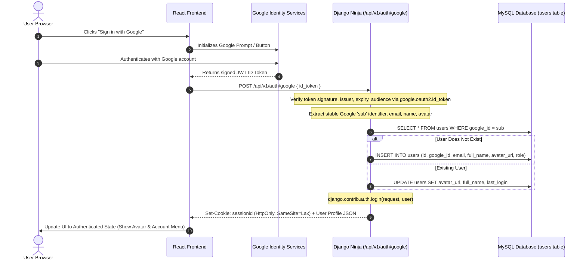

# Simatrix PDF Tools — Core Product Plan: Google-Only Authentication

**Document Reference:** `CORE_PRODUCT_CHECKLIST.md`  
**Milestone:** Stage 1 — Audit & Google-Only Authentication Specification  
**Architecture:** React 18 + Vite | Django 5.1 + Django Ninja + MySQL 8.0  
**Authentication Policy:** **Google Identity Services Only** (No email/password, no local password storage)  

---

## 1. Baseline System Audit

### 1.1 Git & Codebase State
- **Active Branch:** `main` (commit `8dc2c72`, up to date with `origin/main`).
- **Working Tree:** Clean (0 uncommitted changes).
- **Rollback Points:** Branch `backup-pre-php-removal` and Tag `v1.0-pre-php-removal`.
- **PHP Status:** **0 PHP files, 0 PHP dependencies, 0 PHP proxy rules** across the entire repository.

### 1.2 Frontend Audit (React 18 + Vite)
- **Active Routes (14):**
  - `/` &rarr; `Home.jsx`
  - `/pdf-to-jpg` &rarr; `PDFToJPG.jsx`
  - `/pdf-to-word`, `/pdf-to-excel`, `/pdf-to-png`, `/pdf-to-text`, `/pdf-to-ppt`, `/pdf-to-powerpoint`, `/merge-pdf`, `/split-pdf`, `/compress-pdf`, `/rotate-pdf`, `/protect-pdf`, `/images-to-pdf` &rarr; `GenericTool.jsx`
  - `/remove-pages` &rarr; `RemovePages.jsx`
- **UI Gaps & Deficiencies:**
  - Header has no authentication actions or account profile avatar.
  - No dedicated Sign In dialog or page featuring the Google Sign-In button.
  - No account profile or activity history routes (`/account/profile`, `/account/history`).
  - Home page lacks an instant tool search bar with category filter pills.
  - Workspace code duplication across `GenericTool.jsx`, `PDFToJPG.jsx`, and `RemovePages.jsx`.

### 1.3 Backend & Database Audit (Django 5.1 + Django Ninja + MySQL 8.0)
- **Active Database Tables in MySQL `pdf_tool`:**
  - `users` (Custom `User` model with UUID primary key `id`, `email`, `full_name`, `avatar_url`, `is_verified`, `role`).
  - `django_session` (Native Django session table ready for HTTP-only cookie sessions).
- **Installed Packages:**
  - `google.auth` v2.49.0 is already installed and verified in the Python environment.
  - `pymupdf` v1.28.2, `pdf2docx`, `python-docx` active.
- **Active Endpoints (`/api/v1/`):**
  - `GET /health`
  - `GET /capabilities`
  - `POST /convert/pdf-to-word`
  - `POST /security/protect-pdf`
  - `POST /convert/pdf-to-jpg`
  - `GET /download/{token}`
  - `POST /maintenance/cleanup`

---

## 2. Google-Only Authentication Architecture

Per product requirements, **Google Sign-In is the sole supported authentication method**. Local email/password registration, password fields, and local password hashes are strictly prohibited.



### 2.1 Backend Google Token Verification Pipeline
1. **Endpoint:** `POST /api/v1/auth/google` accepts `{ "id_token": "<JWT_STRING>" }`.
2. **Cryptographic Validation (`google-auth`):**
   ```python
   from google.oauth2 import id_token
   from google.auth.transport import requests as google_requests

   idinfo = id_token.verify_oauth2_token(
       token, 
       google_requests.Request(), 
       audience=settings.GOOGLE_CLIENT_ID
   )
   ```
   Validates:
   - Cryptographic signature against Google public keys.
   - Issuer is `https://accounts.google.com` or `accounts.google.com`.
   - Expiration timestamp (`exp > now`).
   - Audience matches configured `GOOGLE_CLIENT_ID`.
3. **Primary Identity Key:** Users are identified strictly by Google's permanent subject ID (`idinfo['sub']`), **never by mutable email strings alone**.
4. **Session Establishment:** Calls Django's `django.contrib.auth.login(request, user)` to generate a cryptographically random, HTTP-only session cookie (`sessionid`).
5. **Zero Local Storage of Tokens:** The Google ID token is discarded immediately after verification. No credentials or tokens are saved to `localStorage`.

### 2.2 Anonymous Access Guarantee
- **100% Free Anonymous Tool Usage:** All 13 document conversion and editing tools remain fully operational without an account.
- **Zero Friction:** Anonymous visitors are never redirected to login or paywalls when uploading, converting, or downloading documents.
- **Optional Account Benefits:** Signing in with Google unlocks:
  1. Personal conversion activity history.
  2. Account profile management.
  3. Increased file-size limit (50MB vs 25MB for anonymous).

### 2.3 Database Schema Changes Required
1. **Update `User` Model (`backend_django/apps/authentication/models.py`):**
   - Add `google_id = models.CharField(max_length=255, unique=True, null=True, blank=True, db_index=True)`.
   - Update `UserManager.create_user` to set unusable passwords by default (`set_unusable_password()`).
2. **Add `ConversionHistory` Model (`backend_django/apps/authentication/models.py`):**
   - Fields: `id` (UUID), `user` (ForeignKey to `User`, CASCADE), `tool_name` (CharField), `tool_id` (CharField), `original_filename` (CharField), `file_size_bytes` (BigIntegerField), `page_count` (IntegerField), `status` (CharField), `created_at` (DateTimeField, auto_now_add=True).
   - **Privacy Rule:** Stores metadata only. Never persists the actual document files.

---

## 3. Core Product Implementation Checklist

```
STAGE 1: Audit & Google-Only Authentication Plan
  [x] Inspect Git status, commit history, and rollback tags.
  [x] Inspect frontend routes, components, and layout architecture.
  [x] Verify google-auth v2.49.0 availability in Python backend.
  [x] Disallow email/password registration, login, and local password storage.
  [x] Define Google ID token verification and sub identifier matching pipeline.
  [x] Define anonymous access policy for all 13 document tools.
  [x] Create CORE_PRODUCT_CHECKLIST.md with detailed roadmap.

STAGE 2: UI Modernization (iLovePDF & iHatePDF Inspired Experience)
  [x] Modernize Home Page & Hero Section:
      - Crisp headline, subtitle, and platform trust metrics (0 sign-up, auto 15-min purge, lossless quality).
      - Prominent live search bar with real-time token and keyword filtering across all 13 tools.
      - Category pill navigation (All Tools 13, Convert from PDF 6, Convert to PDF 1, Organize PDF 4, Optimize & Security 2).
      - Empty-state UI with "Clear Search & Show All Tools" button when search returns no match.
      - Featured utilities strip highlighting popular converters.
  [x] Modernize Navigation Header & Footer:
      - Sticky header with Simatrix logo, categorized tool dropdown, quick search trigger (⌘K / Ctrl+K).
      - Global QuickSearchModal dialog with keyboard arrow navigation and Esc to dismiss.
      - Staged Google Sign-In: "Sign In" button with Google SVG logo and explicit Stage 4 development-state boundary modal.
      - Authenticated UI Preview toggle demonstrating user avatar ("SK"), user display name, and dropdown menu (History, Settings, Sign Out).
      - Accessible mobile menu drawer with quick search, staged sign-in, and full tool accordion.
      - Modernized 4-column footer with verified navigation links, zero legal claims, and strict 15-minute privacy guarantee.
  [x] Standardize Tool Workspace:
      - Multi-tier semantic breadcrumbs ("Home / PDF Tools / [Tool Name]").
      - Reusable drag-and-drop upload zone with format badges, max size indicators, and accessible file selection.
      - Selected file detail card with exact file sizes, page counts, and replace/remove controls.
      - Tool-specific options panels (Split range, Compress levels, Rotate angles, AES password with strength indicator, PPT mode).
      - Truthful progress bar supporting both percentage tracking and indeterminate shimmer states for Python backend operations.
      - Verified success states with actual output file, reduction metrics, and primary download actions.
  [x] Accessible Design System & Themes:
      - Refined dark/light palette complying with WCAG 2.1 AA contrast standards.
      - High-contrast :focus-visible outlines and focus rings across all buttons, inputs, links, and cards.
      - Smooth purposeful micro-interactions and transitions without distracting glass bloat.

### Stage 2 Verification Results
- **Frontend Production Build:** `npm run build` completed cleanly (1809 modules transformed in 14.5s, 0 errors, 0 warnings).
- **Backend Test Suite:** `python manage.py test tests` — 20/20 tests passed in 6.288s (0 failures, 0 errors).
- **Route Integrity:** Verified all 13 tools have active route definitions in `App.jsx` and correspond to valid endpoints.
- **Search & Filter Accuracy:** Verified name matching, keyword token matching, category filtering, and empty-state recovery.
- **Google Sign-In Staging:** Verified development boundary modal and interactive preview toggle for header avatar and dropdown.

STAGE 3: All 13 Existing Document Tools Verification
  [ ] Tool 1: PDF to Word (/pdf-to-word) — Python engine, layout & paragraph retention.
  [ ] Tool 2: Protect PDF (/protect-pdf) — PyMuPDF 256-bit AES, password encryption.
  [ ] Tool 3: PDF to JPG (/pdf-to-jpg) — PyMuPDF high-DPI rendering, ZIP bundling.
  [ ] Tool 4: Merge PDF (/merge-pdf) — Client pdf-lib vector merger.
  [ ] Tool 5: Split PDF (/split-pdf) — Client pdf-lib range extractor, bounds validation.
  [ ] Tool 6: Compress PDF (/compress-pdf) — Anti-bloat vector optimizer.
  [ ] Tool 7: Rotate PDF (/rotate-pdf) — 90/180/270 degree rotation, vector preservation.
  [ ] Tool 8: Remove Pages (/remove-pages) — Interactive visual page selector.
  [ ] Tool 9: Images to PDF (/images-to-pdf) — JPG, PNG, WebP multi-file builder.
  [ ] Tool 10: PDF to PNG (/pdf-to-png) — High-res lossless canvas rendering & ZIP download.
  [ ] Tool 11: PDF to Text (/pdf-to-text) — Clean text stream extractor & .txt download.
  [ ] Tool 12: PDF to Excel (/pdf-to-excel) — Table coordinate clustering into native XLSX.
  [ ] Tool 13: PDF to PowerPoint (/pdf-to-ppt) — Multi-slide AST presentation generator.

STAGE 4: Google Authentication Implementation
  [ ] Database Migration:
      - Add google_id (sub) field to User model.
      - Generate and apply Django migration.
  [ ] Backend Authentication APIs:
      - POST /api/v1/auth/google (ID token verification, sub matching, session creation).
      - GET /api/v1/auth/me (Current user session status).
      - POST /api/v1/auth/logout (Session invalidation).
  [ ] Frontend Google Sign-In Integration:
      - AuthContext (user, isAuthenticated, loading, loginWithGoogle, logout).
      - Official Google Sign-In Button component compliant with Google Identity Guidelines.
      - Dedicated Sign In modal and /signin page.
      - Loading, cancelled-login, and error states.

STAGE 5: Account Experience & Activity History
  [ ] Activity Log Model (ConversionHistory in MySQL, metadata only).
  [ ] Backend History Endpoints:
      - GET /api/v1/account/history (Paginated user-scoped conversion history).
      - DELETE /api/v1/account/history/{id} (Delete record with ownership check).
      - DELETE /api/v1/account/history (Clear user history).
  [ ] Frontend Account Dashboard:
      - /account/profile (Google profile details, avatar, role, sign out).
      - /account/history (Interactive conversion history with search and delete).
      - Zero file storage policy clearly communicated to the user.

STAGE 6: Final Core-Product Testing & Regression
  [ ] Automated Backend Tests:
      - Google auth tests (valid token, invalid signature, expired token, sub matching).
      - Session cookie verification and logout test.
      - History isolation tests (User A cannot access User B's history).
      - Existing 20 conversion tests passing.
  [ ] Production Build & Deployment Checks:
      - npm run build (0 errors).
      - python manage.py check --deploy.
  [ ] End-to-End Browser Verification:
      - Verify anonymous access to all 13 tools.
      - Verify Google Sign-In, profile display, and history logging.
      - Responsive UI checks across desktop, tablet, and mobile.
```
