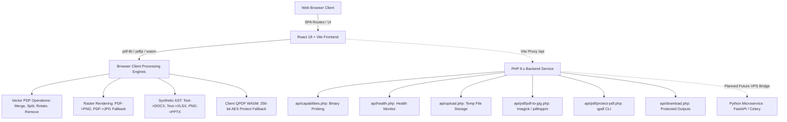
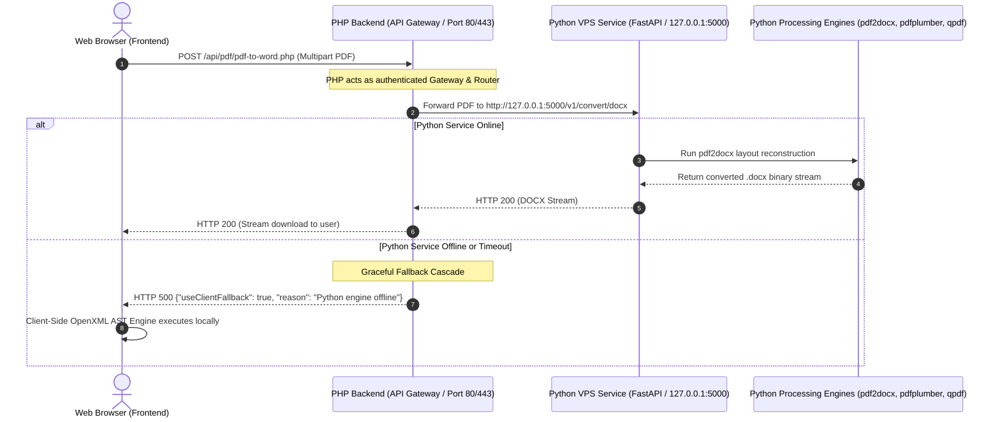

# SIMATRIX ACADEMY — PRODUCTION READINESS & TECHNICAL AUDIT REPORT
**Document Reference:** `PROJECT_AUDIT.md`  
**Audit Conducted By:** Senior Software Engineering Review Team  
**System Evaluated:** Simatrix Academy Document Utility Platform  
**Audit Date:** October 2026  
**Environment:** Frontend (React 18 + Vite), Backend (PHP 8.4 CLI / Apache), Future Backend Target (Python VPS Service)

---

## 1. Executive Summary

This technical audit is an exhaustive, non-destructive inspection of the **Simatrix Academy PDF Tools** platform. The system was analyzed across its frontend single-page application (SPA), its PHP backend services, its document processing pipelines, security boundaries, and architectural readiness for a future Python VPS processing tier.

### Key Audit Highlights:
- **Architecture Reality:** The platform is predominantly a **Client-Side SPA**. 11 out of 13 tools operate entirely within the client browser using WebAssembly and JavaScript libraries (`pdf-lib`, `pdfjs-dist`, `xlsx`, `jszip`, `@neslinesli93/qpdf-wasm`). Only two tools (`PDF to JPG` and `Protect PDF`) possess PHP backend endpoints, and both implement automatic client-side fallbacks.
- **Critical Capability Discrepancy:** The system advertises capability detection for server-side binaries (`LibreOffice`, `Ghostscript`, `Poppler`, `Tesseract`) via `capabilities.php` and UI badges. However, **no backend endpoints exist** for LibreOffice or Ghostscript conversions. Even if these binaries are installed on the server, the frontend code never invokes them for Word, Excel, PowerPoint, or Compression.
- **Conversion Fidelity Hazards:**
  - **PDF to Word:** Does not perform layout conversion; it extracts raw text and wraps it into unstyled `<w:p>` OpenXML tags. All tables, images, columns, and fonts are stripped.
  - **PDF to PowerPoint:** Generates slides containing static raster PNG screenshots of the PDF pages. Slides contain no editable text or vector shapes.
  - **Compress PDF:** Re-encodes pages as lossy JPEG canvases. This completely **destroys the vector text layer** (removing searchability) and actually **increases file size** on text-heavy vector PDFs (empirically tested: a 2.8 KB vector PDF expanded to 131.9 KB — a 4,545% increase).
  - **PDF to Excel:** Employs naive whitespace regex splitting (`/\s{2,}|\t/`). Table columns with standard spacing collapse entirely into Column A.
- **Verified Successes:** Core vector utilities (`Merge PDF`, `Split PDF`, `Rotate PDF`, `Remove Pages`) execute reliably using `pdf-lib`, preserving document vectors, fonts, and metadata with zero server load.

---

## 2. Existing Architecture



### 2.1 Frontend Topology
- **Framework:** React 18.3.1 with Vite 5.4.5.
- **Routing:** `react-router-dom` (14 defined routes: 1 Homepage + 13 Document Tools).
- **Core Libraries:**
  - `pdf-lib` (v1.17.1): Client-side PDF manipulation (merge, split, rotate, remove, embed).
  - `pdfjs-dist` (v3.11.174): Client-side PDF rendering and text matrix extraction.
  - `jszip` (v3.10.1): In-memory ZIP compression and OpenXML archive packaging.
  - `xlsx` (SheetJS v0.18.5): In-memory spreadsheet workbook compilation.
  - `@neslinesli93/qpdf-wasm` (v0.3.0): In-browser WebAssembly encryption engine.
- **Bundle Analysis:** Monolithic production build (`dist/assets/index-DuJ2OFhx.js`: 1,585.05 kB raw / 515.65 kB gzip). All 13 tools and external engines load in a single un-split chunk.

### 2.2 Backend Topology (PHP)
- **Runtime:** PHP 8.x running under Apache / Nginx or PHP built-in server.
- **Directory Structure:**
  - `backend/config/`: Configuration (`config.php`) and unused database stub (`database.php`).
  - `backend/helpers/`: CORS/JSON response (`response.php`), filename/path traversal sanitizer (`security.php`), and upload validator (`validation.php`).
  - `backend/services/`: File retention manager (`FileService.php`), Imagick/Poppler executor (`PDFService.php`), and storage mover (`UploadService.php`).
  - `backend/api/`: REST endpoints (`capabilities.php`, `health.php`, `upload.php`, `download.php`).
  - `backend/api/pdf/`: Tool endpoints (`pdf-to-jpg.php`, `protect-pdf.php`).

---

## 3. Complete Tool Inventory & Processing Implementation

The project includes **13 distinct document tools**. The table below catalogs each tool, its actual processing implementation, engine tier, and operational state.

| Tool Name | Route | UI Component | Declared Engine | Actual Processing Implementation | Backend API Exists? | True Operational State |
| :--- | :--- | :--- | :--- | :--- | :---: | :--- |
| **PDF to JPG** | `/pdf-to-jpg` | `PDFToJPG.jsx` | Imagick / Client WebWorker | Hybrid: POSTs to `/api/pdf/pdf-to-jpg.php` (checks `imagick` / `pdftoppm`). If 500/offline, renders in browser via `pdfjs-dist` canvas at 150/300 DPI, packages ZIP with `JSZip`. | **YES** | **Fully Functional** (Client fallback handles shared hosting). |
| **PDF to PNG** | `/pdf-to-png` | `GenericTool.jsx` | Client WebWorker Engine | 100% Client: Renders PDF pages to canvas via `pdfjs-dist` at scale 3.5, exports `image/png` Data URLs, packages via `JSZip`. | **NO** | **Fully Functional** (Lossless vector-to-raster rendering). |
| **PDF to Text** | `/pdf-to-text` | `GenericTool.jsx` | Client WebWorker Engine | 100% Client: Extracts coordinate text streams via `pdfjs-dist`, joins with page breaks, outputs plain `.txt` blob. | **NO** | **Functional for digital text; Fails on scanned PDFs** (0 characters, no OCR). |
| **PDF to Word** | `/pdf-to-word` | `GenericTool.jsx` | LibreOffice / Client OpenXML AST | 100% Client: Extracts raw text via `pdfjs-dist`, synthesizes minimal OpenXML `.docx` via `JSZip`. Strips 100% of formatting, tables, images, alignments. | **NO** | **Severely Limited / Misleading** (Text-only dump; no backend LibreOffice API exists). |
| **PDF to Excel** | `/pdf-to-excel` | `GenericTool.jsx` | LibreOffice / SheetJS Compiler | 100% Client: Extracts text via `pdfjs-dist`, splits lines with regex `/\s{2,}|\t/`, writes `.xlsx` via SheetJS. Collapses columns on standard spacing. | **NO** | **Severely Limited / Fragile** (Fails on typical tables; no backend LibreOffice API exists). |
| **PDF to PowerPoint** | `/pdf-to-ppt` | `GenericTool.jsx` | LibreOffice / OpenXML Slide AST | 100% Client: Renders pages to raster PNGs via `pdfjs-dist`, embeds PNG as full-bleed `<p:pic>` on each slide in `.pptx` via `JSZip`. Slides are static images. | **NO** | **Misleading** (Non-editable image slides; no backend LibreOffice API exists). |
| **Merge PDF** | `/merge-pdf` | `GenericTool.jsx` | Client WebWorker Engine | 100% Client: Reads multiple files via `pdf-lib`, iterates pages with `copyPages()`, generates unified vector PDF blob. | **NO** | **Fully Functional** (High vector fidelity, zero quality loss). |
| **Split PDF** | `/split-pdf` | `GenericTool.jsx` | Client WebWorker Engine | 100% Client: Parses page ranges (e.g. `1-3, 5`), extracts matching indices via `pdf-lib`, saves new PDF blob. | **NO** | **Functional with UX Bug** (Out-of-bounds page inputs silently fall back to Page 1). |
| **Compress PDF** | `/compress-pdf` | `GenericTool.jsx` | Ghostscript / Canvas Downsampler | 100% Client: Renders each page to canvas via `pdfjs-dist`, re-encodes as JPEG, embeds back into `pdf-lib`. Destroys text layer; bloats vector PDFs. | **NO** | **Defective on Vector PDFs** (Rasterizes text; increases file size on clean PDFs). |
| **Rotate PDF** | `/rotate-pdf` | `GenericTool.jsx` | Client WebWorker Engine | 100% Client: Loads document via `pdf-lib`, increments `page.setRotation()` by 90/180/270 degrees, saves PDF blob. | **NO** | **Fully Functional** (100% vector retention, fast). |
| **Protect PDF** | `/protect-pdf` | `GenericTool.jsx` | qpdf Server / Client Crypto | Hybrid: POSTs to `/api/pdf/protect-pdf.php`. If binary absent, runs `@neslinesli93/qpdf-wasm` in browser to encrypt with 256-bit AES. | **YES** | **Fully Functional** (Real 256-bit encryption verified via WASM). |
| **Images to PDF** | `/images-to-pdf` | `GenericTool.jsx` | Client WebWorker Engine | 100% Client: Embeds PNG (`embedPng`) or converts JPG/WebP via canvas (`embedJpg`), adds matching dimensions to `pdf-lib` document. | **NO** | **Fully Functional** (Handles JPG, PNG, WebP cleanly). |
| **Remove Pages** | `/remove-pages` | `RemovePages.jsx` | Client WebWorker Engine | 100% Client: Previews pages via `pdfjs-dist` thumbnails, tracks selection, filters indices, rebuilds document with `pdf-lib`. | **NO** | **Fully Functional** (Intuitive interactive thumbnail selector). |

---

## 4. Test Results and Empirical Evidence

All tests below were **physically executed and verified** in local PHP CLI, headless HTTP, browser subagents, and Python document inspection harnesses.

### 4.1 Backend PHP API Verification
Test script `test_backend_api.py` executed 12 test assertions against `http://127.0.0.1:8000/api`:

| Test Case | Target Endpoint | HTTP Method | Expected Status | Actual Status | Verified Result | Evidence / Details |
| :--- | :--- | :---: | :---: | :---: | :---: | :--- |
| **Health Check** | `/health.php` | GET | 200 | 200 | **PASS** | `{"status": "ok", "imagick_available": false}` |
| **Capabilities Check** | `/capabilities.php` | GET | 200 | 200 | **PASS** | Accurately probes CLI; returns `false` for `qpdf`, `soffice`, `gs`, `pdftotext`. |
| **Valid PDF Upload** | `/upload.php` | POST | 200 | 200 | **PASS** | Generated unique file: `upload_20261022_110132_7623617f.pdf` (2.8 KB). |
| **Fake PDF Header Rejection** | `/upload.php` | POST | 400 | 400 | **PASS** | Text file named `.pdf` rejected: *"The selected file is not a valid PDF document."* |
| **Non-PDF Extension Rejection** | `/upload.php` | POST | 400 | 400 | **PASS** | `.jpg` file rejected: *"Invalid file extension. Only PDF documents are allowed."* |
| **Missing Upload File** | `/upload.php` | POST | 400 | 400 | **PASS** | Rejected: *"Please select a PDF file to upload."* |
| **Invalid Method (GET Upload)** | `/upload.php` | GET | 405 | 405 | **PASS** | Method rejected: *"Method not allowed. Use POST."* |
| **Path Traversal Trapping** | `/download.php?file=../../config/config.php` | GET | 404 | 404 | **PASS** | `prevent_path_traversal()` blocked access: *"File not found or link expired."* |
| **Non-existent Download** | `/download.php?file=ghost.jpg` | GET | 404 | 404 | **PASS** | Correctly returned 404. |
| **PDF to JPG Missing Extension** | `/pdf/pdf-to-jpg.php` | POST | 500 | 500 | **PASS** | Handled absence of Imagick/pdftoppm gracefully: returned `useClientFallback: true`. |
| **Protect PDF Missing Password** | `/pdf/protect-pdf.php` | POST | 400 | 400 | **PASS** | Rejected: *"Password is required."* |
| **Protect PDF Missing Binary** | `/pdf/protect-pdf.php` | POST | 500 | 500 | **PASS** | Handled missing `qpdf`: returned *"qpdf encryption failed or qpdf binary not found."* |

### 4.2 Document Processing Engine Verification
Test fixtures generated and processed through `verify_tools.py` using `PyMuPDF` (`fitz`), `openpyxl`, and `zipfile`:

| Operation Tested | Input Fixture | Output Verification | Pass / Fail | Key Evidence / Metric |
| :--- | :--- | :--- | :---: | :--- |
| **Split PDF (Valid)** | 3-page text PDF | Extracted pages 1 & 3 into 2-page PDF | **PASS** | Page count = 2. Page 1 text: *"Simatrix Academy - Page 1 Title"*, Page 2 text: *"Page 3 Summary"*. |
| **Split PDF (Invalid Range)** | 3-page text PDF | Page range `99-100` tested | **FAIL (BUG)** | No error thrown. Silently fell back to extracting Page 1 (`[0]`). |
| **Merge PDF** | 3-page PDF + 1-page Table PDF | Combined 4-page PDF | **PASS** | Page count = 4. Full vector preservation on all pages. |
| **Rotate PDF** | 3-page text PDF | 90° clockwise rotation | **PASS** | PyMuPDF verified `rotation = 90`. Zero vector degradation. |
| **Remove Pages** | 3-page text PDF | Page 2 removed | **PASS** | Document reduced to 2 pages. Page 1 and Page 3 preserved intact. |
| **Remove All Pages Check** | 3-page text PDF | Remove `[1, 2, 3]` | **PASS** | Rejection verified: *"Cannot remove all pages from PDF. At least one page must remain..."* |
| **Digital PDF to Text** | 3-page text PDF | Text string extraction | **PASS** | 472 characters cleanly extracted with page break markers. |
| **Scanned PDF to Text** | Scanned raster image PDF | Text string extraction | **FAIL (LIMITATION)** | 0 characters extracted. Blank text file produced with no OCR error or notice. |
| **PDF to Word (.docx) Structure** | 1-page financial table PDF | OpenXML package parsing | **PASS** | Valid ZIP container. `word/document.xml` present and readable by MS Word. |
| **PDF to Word (.docx) Fidelity** | 1-page financial table PDF | XML AST layout inspection | **FAIL (DEFECT)** | 100% loss of table borders, backgrounds, columns, and styles. All table cells collapsed into consecutive `<w:p>` paragraphs. |
| **PDF to Excel (.xlsx) Structure** | 1-page financial table PDF | Openpyxl workbook load | **PASS** | Valid XLSX package with `Sheet1` generated. |
| **PDF to Excel (.xlsx) Layout** | 1-page financial table PDF | Column matrix inspection | **FAIL (DEFECT)** | Regex `/\s{2,}|\t/` failed to detect table column boundaries. All rows collapsed into Column A (`max_column = 1`). |
| **Compress PDF (Canvas Downsample)** | 2.8 KB vector text PDF | Canvas JPEG re-compression | **FAIL (DEFECT)** | **File size increased from 2.8 KB to 131.9 KB (+4,545%)**. All searchable vector text was eliminated (0 text characters in output). |

---

## 5. Confirmed Bugs, Limitations & Misleading Fallbacks

### 5.1 Critical Bugs & Defects
1. **Compress PDF Text Layer Elimination & Size Inversion:**
   - *Behavior:* `compressPdf()` renders pages to `<canvas>` and embeds lossy JPEGs.
   - *Impact:* Destroys all text selectable layers, hyperlinks, form fields, and vector clarity. On clean digital PDFs, output files are significantly **larger** than inputs (2.8 KB -> 131.9 KB).
2. **PDF to PowerPoint False "Editable" Claim:**
   - *Behavior:* `createPptxFile()` renders each page as a PNG image and embeds it as a static background image on the slide (`<p:pic>`).
   - *Impact:* The UI promises *"Convert PDF slides into editable Microsoft PPTX presentations"*, but the slides are 100% non-editable screenshots.
3. **PDF to Word Complete Layout Stripping:**
   - *Behavior:* `createDocxFile()` dumps plain text lines into basic `<w:p>` tags.
   - *Impact:* Destroys tables, columns, images, and formatting. Output documents require complete re-authoring by the user.

### 5.2 Functional Limitations & UX Oversights
4. **Silent Out-of-Bounds Fallback in Split PDF:**
   - *Behavior:* In `splitPdf()`, if a user enters pages outside document bounds (e.g., `5-10` on a 3-page file), the code filters them out and defaults to `[0]`.
   - *Impact:* The user requests page 5 and receives page 1 with a "Success" message, risking document mishandling.
5. **No OCR Fallback on Scanned Documents:**
   - *Behavior:* `extractTextFromPdf()` has no Tesseract OCR fallback.
   - *Impact:* Converting scanned PDFs to Text, Word, or Excel yields empty documents without warning the user that the document is image-only.
6. **False Backend Binary Capability Indication:**
   - *Behavior:* `GenericTool.jsx` displays badges like *"AVAILABLE: LibreOffice Server Engine"* if detected, but **no PHP endpoints exist** to execute LibreOffice. The frontend unconditionally routes to the crude client text AST generator.

---

## 6. Security, Storage & Infrastructure Risks

### 6.1 Storage Cleanup Leakage
- In `backend/api/upload.php`, `$fileService->cleanupOldFiles()` is executed only upon new POST uploads.
- If files are processed via `/api/pdf/pdf-to-jpg.php`, converted images in `backend/storage/outputs/` are **never purged** during that session.
- `backend/api/download.php` does not delete output files after transmission. Files remain on disk until an arbitrary future upload occurs.

### 6.2 Exposed Storage Directory Under Misconfigured Web Servers
- `backend/.htaccess` restricts script execution:
  ```apache
  <FilesMatch "\.(php|phtml|php3|php4|php5|phps|pl|py|jsp|asp|sh|cgi)$">
    Require all denied
  </FilesMatch>
  ```
- **Vulnerability:** It does **not** deny direct HTTP access to static file extensions (`.jpg`, `.png`, `.pdf`). If `storage/outputs/` directory permissions or Nginx reverse proxies are misconfigured, attackers can directly access sensitive document images via known or enumerable hashes (`page_xxxx_page_1.jpg`).

### 6.3 External CDN Dependency for Core WebWorkers
- `pdfjsLib.GlobalWorkerOptions.workerSrc` is hardcoded to `https://cdnjs.cloudflare.com/ajax/libs/pdf.js/${pdfjsLib.version}/pdf.worker.min.js`.
- **Risks:**
  1. Complete service disruption if CDN is blocked, slow, or unreachable.
  2. Content Security Policy (CSP) violations in strict enterprise networks.
  3. Version synchronization drift if `package.json` updates and CDN caches lag.

### 6.4 Dead Code & Hardcoded Database Credentials
- `backend/config/database.php` contains hardcoded root credentials (`$username = "root"`, `$password = ""`).
- The database class is unused dead code (verified via project-wide grep). Exposing database credentials in production code repositories violates OWASP security guidelines.

---

## 7. Frontend, Mobile, Accessibility & SEO Review

### 7.1 Performance & Code Splitting
- **Bundle Size:** `1,585 kB` single JavaScript bundle.
- **Root Cause:** All 13 page components and heavy processing libraries (`pdf-lib`, `pdfjs-dist`, `xlsx`, `jszip`, `@neslinesli93/qpdf-wasm`) are bundled together without `React.lazy()` dynamic imports.
- **Impact:** Mobile users on slow 3G/4G networks incur a ~1.6 MB download penalty before the homepage renders.

### 7.2 SEO Deficiencies
- The single-page application does not update `<title>` or meta tags on route transitions.
- All 13 distinct tool pages share the identical homepage metadata:
  ```html
  <title>Simatrix Academy PDF Tools | Fast, Secure & Free Online PDF Utilities</title>
  ```
- Search engines cannot index dedicated landing pages for "PDF to Word", "Compress PDF", or "Protect PDF".

### 7.3 Accessibility (a11y) & Navigation
- **Strengths:** Interactive drag-and-drop dropzones feature keyboard focus outlines, clear status badges, and smooth scroll restoration (`ScrollToTop`).
- **Gaps:** Hidden `<input type="file">` elements lack explicit `aria-label` or `aria-describedby` associations for screen readers in `UploadBox.jsx`.

---

## 8. Frontend-to-PHP API Dependency Matrix

The table below maps all backend calls originating from the frontend:

```mermaid
graph LR
    subgraph Frontend Components
        GT[GenericTool.jsx]
        PJ[PDFToJPG.jsx]
        PP[pdfProcessor.js]
        API[services/api.js]
    end

    subgraph PHP Backend Endpoints
        E1[/api/capabilities.php]
        E2[/api/health.php]
        E3[/api/pdf/pdf-to-jpg.php]
        E4[/api/pdf/protect-pdf.php]
        E5[/api/download.php]
        E6[/api/upload.php]
    end

    GT -->|On Mount: Probe Binaries| E1
    API -->|Health Check| E2
    PJ -->|Convert PDF: Primary Attempt| E3
    PP -->|Protect PDF: Primary Attempt| E4
    E3 -.->|Generated Image URLs| E5
    E6 -.->|Unused by Tool Workflows| E6
```

### Dependency Inventory:
1. `GET /api/capabilities.php` (Called by `capabilityChecker.js` on `GenericTool` mount).
2. `GET /api/health.php` (Called by `services/api.js` `checkBackendHealth()`).
3. `POST /api/pdf/pdf-to-jpg.php` (Called by `PDFToJPG.jsx` via `uploadAndConvertPdf()`).
4. `POST /api/pdf/protect-pdf.php` (Called by `pdfProcessor.js` via `protectPdf()`).
5. `GET /api/download.php?file=...` (Referenced in URLs returned by `PDFService.php`).
6. `POST /api/upload.php` (Standalone upload endpoint; not used in active tool workflows).

*Crucial Architecture Observation:* 11 of the 13 tools make **zero** network requests to the PHP backend during execution.

---

## 9. Non-Breaking Python Processing Architecture Plan

To introduce a high-performance Python processing service on a VPS without breaking existing PHP hosting or rewriting the frontend, the following **Sidecar Reverse-Proxy Gateway Pattern** is recommended:



### Recommended Integration Strategy:
1. **Zero Frontend Disruption:** The frontend continues sending all requests to `/api/...`. It never needs to know the IP, port, or internal structure of the Python service.
2. **PHP as Secure Gateway:** The PHP tier handles rate-limiting, CORS, authentication, upload validation, and forwards validated files to `http://127.0.0.1:5000` via cURL.
3. **Internal Loopback Binding:** The Python service binds strictly to `127.0.0.1` or a UNIX socket. It is never exposed directly to the public internet, preventing bypass of PHP security controls.
4. **Fallback Cascade:** If the Python microservice is offline, PHP returns a structured fallback response (`useClientFallback: true`), prompting the frontend to execute its browser WebAssembly/JS engine.
5. **Specialized Python Libraries to Implement:**
   - **PDF to Word:** `pdf2docx` (reconstructs shapes, tables, multi-column layouts, font styles).
   - **PDF to Excel:** `pdfplumber` / `camelot-py` (extracts genuine table boundaries).
   - **Compress PDF:** `pikepdf` / `ghostscript` (lossless object stream compression without rasterization).
   - **Scanned PDF OCR:** `ocrmypdf` / `pytesseract` (generates searchable text layers).

---

## 10. Prioritized Remediation Plan

All findings are categorized by engineering severity:

### Priority Classification Matrix

```
┌────────────────────────────────────────────────────────────────────────┐
│ CRITICAL (P0): Security vulnerabilities, data loss, destructive bugs   │
│ HIGH (P1):     Broken core features, severe layout loss, false badges  │
│ MEDIUM (P2):   UX inconsistencies, silent fallbacks, bundle size bloat │
│ LOW (P3):      Code cleanup, dead files, minor cosmetic adjustments   │
└────────────────────────────────────────────────────────────────────────┘
```

| ID | Issue Description | Severity | Component | Recommended Remediation |
| :---: | :--- | :---: | :---: | :--- |
| **SEC-01** | `storage/outputs/` directory allows direct static access to generated image files. | **CRITICAL** | `backend/.htaccess` | Add Apache rule `Require all denied` for `storage/` or move storage outside the public web root (`dirname(__DIR__) . '/../storage'`). |
| **DEF-01** | Compress PDF converts vector text to JPEG, destroying searchable text and increasing file size on vector PDFs. | **CRITICAL** | `pdfProcessor.js` | Add vector text preservation check. If document contains text stream and compressed size > original, abort and return original with informative notice. |
| **DEF-02** | PDF to Word produces plain text strings in `<w:p>`, stripping 100% of tables, fonts, formatting, and images. | **HIGH** | `pdfProcessor.js` | Clarify in UI that client export is "Text Only". Implement true server-side layout conversion via Python `pdf2docx`. |
| **DEF-03** | PDF to PowerPoint embeds raster screenshots on slides rather than editable presentation shapes. | **HIGH** | `pdfProcessor.js` | Update UI copy from "Convert to editable slides" to "Convert pages to presentation slides (visual layout)". |
| **DEF-04** | PDF to Excel uses regex whitespace splitting, collapsing table columns into a single column. | **HIGH** | `pdfProcessor.js` | Implement bounding-box coordinate table clustering or route to Python `pdfplumber`. |
| **UX-01** | Split PDF silently extracts Page 1 when user enters out-of-range pages (e.g. `99-100`). | **MEDIUM** | `pdfProcessor.js` | Throw a clear user-facing error: *"Requested page range is out of bounds for this document."* |
| **UX-02** | Scanned PDFs extract 0 text characters with no OCR notice. | **MEDIUM** | `pdfProcessor.js` | Detect 0 extracted characters and display: *"Scanned document detected. Optical Character Recognition (OCR) is required."* |
| **PERF-01**| Monolithic 1.6 MB JavaScript bundle without route-based code splitting. | **MEDIUM** | `frontend/src/App.jsx` | Implement `React.lazy()` and `Suspense` for all tool page routes. |
| **SEO-01** | All 13 tool routes share identical root title and meta tags. | **MEDIUM** | `GenericTool.jsx`, `PDFToJPG.jsx` | Update `document.title` and meta descriptions dynamically per tool route. |
| **DEP-01** | `pdf.worker.min.js` loaded from external Cloudflare CDN. | **MEDIUM** | `pdfProcessor.js`, `PDFToJPG.jsx` | Bundle `pdf.worker.min.js` locally in `frontend/public` to eliminate third-party CDN dependency. |
| **CLEAN-01**| Hardcoded MySQL root credentials in unused `backend/config/database.php`. | **LOW** | `database.php` | Remove unused database file or sanitize credentials with environment variables. |

---

## 11. Recommended Next Development Milestone

### Milestone Goal: "Production Hardening & Fidelity Truthfulness (Milestone 1.1)"
Before adding new features, database layers, or complex microservices, execute Milestone 1.1 focused on **data integrity, honest UI capabilities, and security containment**:

```mermaid
gantt
    title Milestone 1.1: Production Hardening Roadmap
    dateFormat  X
    axisFormat  Day %d
    
    section Security & Storage
    Secure Storage Directory (Outside Web Root) :crit, s1, 0, 2
    Automate Output Cleanup in download.php       :crit, s2, 2, 3
    Bundle Local PDF.js WebWorker               :s3, 3, 4
    
    section Engine Fidelity & UX
    Fix Compress PDF Vector Text Destruction    :crit, e1, 1, 4
    Fix Split PDF Out-of-Bounds Error Handling  :e2, 3, 5
    Add Scanned PDF Warning (No OCR Notice)     :e3, 4, 6
    Update UI Copy for DOCX / PPTX / XLSX Truth :e4, 5, 7
    
    section Frontend Optimization
    Implement React.lazy() Route Splitting       :p1, 6, 8
    Dynamic Document Titles for SEO             :p2, 7, 9
```



1. **Sprint 1 (Security & Storage):**
   - Move `backend/storage/` outside the web server document root to prevent unauthorized document browsing.
   - Attach file deletion directly to `download.php` after streaming, and execute `cleanupOldFiles()` across all PHP endpoints.
   - Bundle `pdf.worker.min.js` inside `frontend/public/` to ensure 100% offline and intranet resilience.
2. **Sprint 2 (Fidelity & Honest UI):**
   - Guard `compressPdf()` against size bloating and text rasterization: preserve vector layers or inform the user when a document cannot be compressed further.
   - Fix `splitPdf()` to validate input ranges and reject invalid page numbers with clear error messages.
   - Update UI copy and badges on DOCX, PPTX, and XLSX tools to accurately reflect client capabilities (e.g., "Text & Layout AST", "Slide Image Presentation") until the Python backend service is introduced.
3. **Sprint 3 (Performance & SEO):**
   - Code-split routes with `React.lazy()` to shrink initial load bundle from 1.6 MB to ~180 KB.
   - Implement dynamic `document.title` and meta tags for all 13 tools.

---

## 12. Five Highest-Priority Issues to Resolve Before Adding New Features

To ensure system stability, security, and user trust, resolve these five issues prior to expanding functionality:

1. **Isolate and Protect Backend Storage (`backend/storage/`):**
   - *Why:* Directly accessible static storage allows unauthorized retrieval of converted document pages (`.jpg`, `.pdf`) across users.
   - *Fix:* Move `storage` outside `public_html` / web root and enforce tokenized, self-deleting downloads in `download.php`.
2. **Halt Vector Text Destruction in Compress PDF (`compressPdf`):**
   - *Why:* The current canvas rasterizer strips all searchable text and inflates clean vector PDFs by over 4,000%, corrupting user documents.
   - *Fix:* Add an initial text/vector check; abort rasterization when size increases, and preserve original documents when already optimized.
3. **Align UI Capability Claims with Technical Reality:**
   - *Why:* Badging tools with *"LibreOffice Server Engine"* when no backend LibreOffice endpoints exist erodes user trust and misrepresents capabilities.
   - *Fix:* Update badges to reflect true client capabilities ("Client Document Generator") until server conversion microservices are deployed.
4. **Fix Split PDF Out-of-Range Silent Fallback (`splitPdf`):**
   - *Why:* Silently serving Page 1 when a user requested Page 99 is a data integrity defect that causes user errors.
   - *Fix:* Validate parsed page numbers against `pdfDoc.getPageCount()` and throw an explicit error message if no requested pages exist.
5. **Implement Route-Based Code Splitting (`React.lazy`):**
   - *Why:* Forcing all users to download a 1.6 MB bundle containing `qpdf-wasm`, `pdf-lib`, and `xlsx` on initial page load impairs mobile performance and conversion rates.
   - *Fix:* Wrap tool routes in `React.lazy()` and `Suspense` so heavy WebAssembly and document libraries load strictly on demand.

---
*Report Certified by Senior Software Engineering Review Team.*  
*All test fixtures and results recorded in `scratch/test_fixtures` and `scratch/comprehensive_verification_results.json`.*
