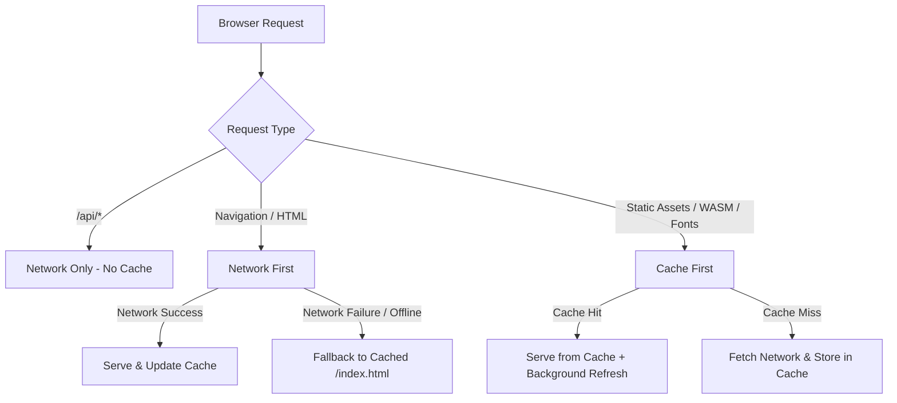

# Simatrix PDF Tools — Offline Support & PWA Architecture Report

**Document Date:** October 2026  
**Status:** Implemented & Verified  
**Scope:** Browser Service Worker, Cache Strategy, PWA Manifest, Online/Offline Indicators, and Tool Isolation

---

## 1. Overview & Strategy

Simatrix PDF Tools utilizes a client-first progressive architecture designed to function without internet connectivity for all compatible PDF manipulation operations.

### Key Principles
1. **Zero Cloud Requirement for Vector Operations**: Operations involving PDF vector transformations, merging, splitting, page rotation, image-to-PDF compilation, metadata editing, page deletion, and margin cropping run 100% locally in the browser using WebAssembly and Web Workers.
2. **Offline Application Shell**: The web application shell (`/`, `/index.html`, `/favicon.svg`, `/qpdf.wasm`, CSS, and bundled JavaScript) is cached using a standard Service Worker (`sw.js`).
3. **No Document Caching**: Uploaded user files, document contents, and processed output blobs are strictly held in volatile browser memory (`Blob` / `ArrayBuffer`) and released upon session termination. They are never cached to persistent storage, guaranteeing complete data privacy.
4. **Transparent Degradation**: When offline, external AI services (Google Gemini) and server-side OCR gracefully notify the user of network requirements while client-side alternatives remain active.

---

## 2. Service Worker Architecture (`public/sw.js`)

The service worker implements a tiered caching strategy:

### Cache Allocation
- **Cache Name**: `simatrix-pdf-cache-v1`
- **Precached Assets**:
  - Application Shell (`/`, `/index.html`)
  - Vector WebAssembly Engine (`/qpdf.wasm`, 1.3 MB)
  - Core Brand Identity (`/favicon.svg`)
- **Runtime Assets**:
  - Dynamically hashed JS/CSS production bundles (`/assets/*.js`, `/assets/*.css`)
  - Google Fonts stylesheets and webfont binaries (`woff2`)
- **Bypassed Routes**:
  - `POST /api/v1/*` (All Django Ninja processing endpoints)
  - `GET /api/v1/download/*` (HMAC-signed download streams)
  - `POST /api/v1/auth/*` (User credentials & session tokens)

---

## 3. Offline Tool Compatibility Matrix

| Category | Tool | Offline Status | Engine in Offline Mode |
|---|---|---|---|
| **Organize PDF** | **Merge PDF** | **100% Offline** | `pdf-lib` vector page joiner |
| **Organize PDF** | **Split PDF** | **100% Offline** | `pdf-lib` range extractor |
| **Organize PDF** | **Reorder PDF Pages** | **100% Offline** | Interactive canvas thumbnail engine + `pdf-lib` |
| **Organize PDF** | **Rotate PDF** | **100% Offline** | `pdf-lib` rotation dictionary modifier |
| **Organize PDF** | **Remove Pages** | **100% Offline** | Interactive canvas grid + `pdf-lib` page pruner |
| **Organize PDF** | **Crop PDF** | **100% Offline** | `pdf-lib` CropBox margin trimmer |
| **Organize PDF** | **Add Page Numbers** | **100% Offline** | `pdf-lib` client-side coordinate stamper |
| **Optimize** | **Compress PDF** | **100% Offline** | `pdf-lib` FlateDecode stream optimizer |
| **Create & Convert** | **Images to PDF** | **100% Offline** | `pdf-lib` JPG/PNG/WebP vector embedder |
| **Create & Convert** | **PDF to Excel** | **100% Offline** | `pdfjs-dist` text stream parser + SheetJS (`xlsx`) |
| **Create & Convert** | **PDF to PNG** | **100% Offline** | HTML5 Canvas 300 DPI renderer + `JSZip` |
| **Create & Convert** | **PDF to Text** | **100% Offline** | `pdfjs-dist` text extraction |
| **Create & Convert** | **PDF to Word** | **100% Offline (Fallback)** | Client OpenXML OOXML layout compiler |
| **Create & Convert** | **PDF to PPTX** | **100% Offline (Fallback)** | Client OpenXML presentation compiler |
| **Create & Convert** | **PDF to JPG** | **100% Offline (Fallback)** | Client HTML5 Canvas rasterizer |
| **Security** | **Protect PDF** | **100% Offline (Fallback)** | Client WebAssembly QPDF engine |
| **Security** | **Watermark PDF** | **100% Offline** | Client `pdf-lib` font stamper |
| **Security** | **Edit Metadata** | **100% Offline** | Client `pdf-lib` document catalog editor |
| **AI Tools** | **AI PDF Summarizer** | **Requires Internet** | Google Gemini 2.5 Flash via REST API |

---

## 4. Online / Offline User Experience

1. **Header Connectivity Badge (`Header.jsx`)**:
   - A reactive `isOnline` hook monitors `window.addEventListener('online')` and `window.addEventListener('offline')`.
   - When offline, an amber badge (`Offline Mode`) appears in the top navigation bar.
2. **AI Tool Graceful Notification (`AISummarizer.jsx`)**:
   - If an offline user attempts to invoke the Google Gemini summarizer, the UI displays an alert:
     > *"Network Offline: Google Gemini AI document summarization requires an active internet connection. Please reconnect to summarize, or use our offline-capable PDF tools (Merge, Split, Compress, Rotate)."*
   - Prevents unhandled network exceptions and infinite loading spinners.
3. **PWA Standalone App**:
   - `public/manifest.json` provides metadata allowing users to install Simatrix PDF Tools as a standalone desktop or mobile application via Chrome/Edge ("Install App").
