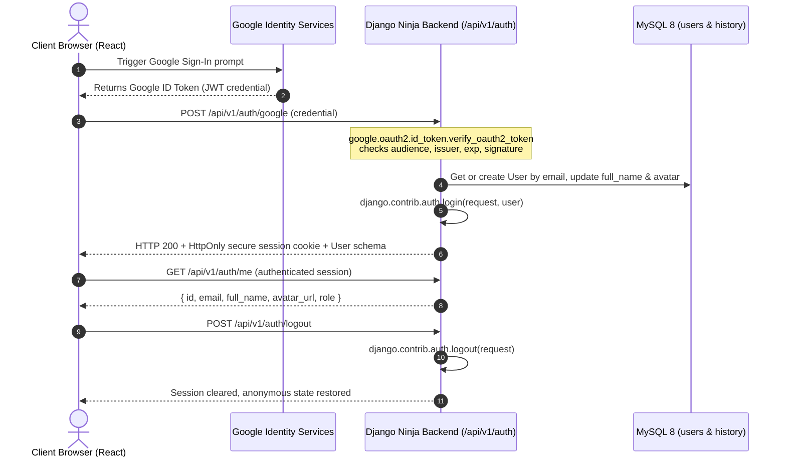

# Simatrix PDF Tools — Complete UI/UX Redesign & Authentication Upgrade Plan

> **Document Status**: Phase A Master Specification & Architecture Plan  
> **Target Application**: Simatrix PDF Tools (React 18 + Vite, Django 5.1 + Django Ninja, MySQL 8)  
> **Prepared**: October 2026

---

## 1. Executive Summary & Baseline Inventory

Simatrix PDF Tools is a production web application delivering **19 document intelligence and PDF manipulation utilities**. The processing model is split into:
1. **Client-Side WASM / WebWorker Tools (10 tools)**: Fast, private, in-browser processing via `pdf-lib`, `@neslinesli93/qpdf-wasm`, and `pdfjs-dist`.
2. **Backend Server-Side Python Engines (8 tools)**: High-fidelity transformations using PyMuPDF (`fitz`), `pdf2docx`, and `python-pptx`.
3. **AI Intelligence Engine (1 tool)**: Production PDF Summarizer powered by **Google Gemini API** (`gemini-3.1-flash-lite`) with Map-Reduce chunking.

While the processing engines and core utilities are fully functional with 54 passing backend tests, the frontend experience currently exhibits:
- Fragmented page architectures between `GenericTool.jsx` and dedicated pages (`PDFToJPG.jsx`, `RemovePages.jsx`, `ReorderPages.jsx`, `AISummarizer.jsx`).
- Ad-hoc CSS across individual page styles rather than a unified design token system.
- An unauthenticated staging modal (`GoogleAuthStagingModal.jsx`) that simulates auth via local state rather than authenticating against Django with real Google ID tokens.
- Absence of user profile, document history, and account settings interfaces.

This redesign plan defines the blueprint to transform Simatrix PDF Tools into a **modern, unified, enterprise-grade SaaS product**.

---

## 2. Comprehensive Route & Page Inventory

| # | Route Path | Current Component | Processing Tier | Active Engine / Implementation |
|---|------------|-------------------|-----------------|--------------------------------|
| 1 | `/` | `Home.jsx` | Mixed | Hero, category tabs, tool grid, feature callouts, capabilities badge |
| 2 | `/pdf-to-word` | `GenericTool.jsx` | **Server-Side** | Django Ninja: `POST /api/v1/convert/pdf-to-word` (`pdf2docx` + bullet repair) |
| 3 | `/pdf-to-jpg` | `PDFToJPG.jsx` | **Hybrid** | Client Canvas / Server `POST /api/v1/convert/pdf-to-jpg` (DPI selection, ZIP) |
| 4 | `/merge-pdf` | `GenericTool.jsx` | **Client-Side** | `pdf-lib` + `@neslinesli93/qpdf-wasm` (Multi-file reorder & merge) |
| 5 | `/compress-pdf` | `GenericTool.jsx` | **Client-Side** | `@neslinesli93/qpdf-wasm` (QPDF stream compression & linearization) |
| 6 | `/split-pdf` | `GenericTool.jsx` | **Client-Side** | `pdf-lib` (Page range extraction / split into single pages) |
| 7 | `/pdf-to-excel` | `GenericTool.jsx` | **Client-Side** | `pdfjs-dist` text stream table parser to `.xlsx` / `.csv` |
| 8 | `/pdf-to-png` | `GenericTool.jsx` | **Client-Side** | `pdfjs-dist` Canvas rasterizer with alpha transparency channel |
| 9 | `/pdf-to-text` | `GenericTool.jsx` | **Client-Side** | `pdfjs-dist` text stream extraction into UTF-8 `.txt` |
| 10 | `/pdf-to-ppt` | `GenericTool.jsx` | **Server-Side** | Django Ninja: `POST /api/v1/convert/pdf-to-powerpoint` (`python-pptx`) |
| 11 | `/pdf-to-powerpoint` | `GenericTool.jsx` | **Server-Side** | Canonical alias for `/pdf-to-ppt` |
| 12 | `/rotate-pdf` | `GenericTool.jsx` | **Client-Side** | `pdf-lib` (90°, 180°, 270° orientation transform) |
| 13 | `/protect-pdf` | `GenericTool.jsx` | **Server-Side** | Django Ninja: `POST /api/v1/security/protect-pdf` (PyMuPDF AES-256) |
| 14 | `/images-to-pdf` | `GenericTool.jsx` | **Client-Side** | `pdf-lib` (Multi-image JPG/PNG/WebP to PDF stitcher) |
| 15 | `/remove-pages` | `RemovePages.jsx` | **Client-Side** | `pdfjs-dist` visual thumbnails + `pdf-lib` page deletion |
| 16 | `/add-page-numbers` | `GenericTool.jsx` | **Server-Side** | Django Ninja: `POST /api/v1/tools/add-page-numbers` (PyMuPDF formatting) |
| 17 | `/watermark-pdf` | `GenericTool.jsx` | **Server-Side** | Django Ninja: `POST /api/v1/tools/watermark` (PyMuPDF overlay) |
| 18 | `/crop-pdf` | `GenericTool.jsx` | **Server-Side** | Django Ninja: `POST /api/v1/tools/crop` (PyMuPDF bounding box margins) |
| 19 | `/edit-metadata` | `GenericTool.jsx` | **Server-Side** | Django Ninja: `POST /api/v1/tools/metadata` (PyMuPDF Title, Author, etc.) |
| 20 | `/reorder-pdf` | `ReorderPages.jsx` | **Server-Side** | Django Ninja: `POST /api/v1/tools/reorder` (PyMuPDF page permutation) |
| 21 | `/organize-pdf` | `ReorderPages.jsx` | **Server-Side** | Canonical alias for `/reorder-pdf` |
| 22 | `/ai-summarizer` | `AISummarizer.jsx` | **AI Server** | Django Ninja: `POST /api/v1/ai/summarize` (Google Gemini 3.1 Flash Lite) |
| 23 | `/login` *(New)* | *To be built* | Client/API | Dedicated Google OAuth Sign-in & Authentication status view |
| 24 | `/account` *(New)* | *To be built* | Client/API | User Profile, authenticated status, security settings, account deletion |
| 25 | `/history` *(New)* | *To be built* | Client/API | Personal document processing history (metadata only, zero file storage) |
| 26 | `*` *(New)* | *To be built* | Client | Branded 404 Not Found error page with search redirect |

---

## 3. Tool Processing Engine Matrix

| Tool Identifier | Route | Processing Location | Library / SDK | Request Endpoint / Hook | Output Mime / File |
|---|---|---|---|---|---|
| `pdf-to-word` | `/pdf-to-word` | Backend Django | `pdf2docx`, `python-docx` | `POST /api/v1/convert/pdf-to-word` | `application/vnd.openxmlformats-officedocument.wordprocessingml.document` (`.docx`) |
| `pdf-to-ppt` | `/pdf-to-ppt` | Backend Django | `pymupdf`, `python-pptx` | `POST /api/v1/convert/pdf-to-powerpoint` | `application/vnd.openxmlformats-officedocument.presentationml.presentation` (`.pptx`) |
| `protect-pdf` | `/protect-pdf` | Backend Django | `pymupdf` (PyMuPDF) | `POST /api/v1/security/protect-pdf` | `application/pdf` (`.pdf`) |
| `add-page-numbers` | `/add-page-numbers` | Backend Django | `pymupdf` | `POST /api/v1/tools/add-page-numbers` | `application/pdf` (`.pdf`) |
| `watermark-pdf` | `/watermark-pdf` | Backend Django | `pymupdf` | `POST /api/v1/tools/watermark` | `application/pdf` (`.pdf`) |
| `crop-pdf` | `/crop-pdf` | Backend Django | `pymupdf` | `POST /api/v1/tools/crop` | `application/pdf` (`.pdf`) |
| `edit-metadata` | `/edit-metadata` | Backend Django | `pymupdf` | `POST /api/v1/tools/metadata` | `application/pdf` (`.pdf`) |
| `reorder-pdf` | `/reorder-pdf` | Backend Django | `pymupdf` + `pdfjs-dist` | `POST /api/v1/tools/reorder` | `application/pdf` (`.pdf`) |
| `ai-summarizer` | `/ai-summarizer` | Backend Django + AI | `google-genai` (Gemini 3.1) | `POST /api/v1/ai/summarize` | `application/json` (Markdown summary) |
| `pdf-to-jpg` | `/pdf-to-jpg` | Client (fallback API) | `pdfjs-dist` (Canvas) | Client render / `POST /api/v1/convert/pdf-to-jpg` | `image/jpeg` / `application/zip` |
| `pdf-to-png` | `/pdf-to-png` | Client Browser | `pdfjs-dist` (Canvas) | Client render / `JSZip` | `image/png` / `application/zip` |
| `pdf-to-text` | `/pdf-to-text` | Client Browser | `pdfjs-dist` text-stream | Client text extraction | `text/plain` (`.txt`) |
| `pdf-to-excel` | `/pdf-to-excel` | Client Browser | `pdfjs-dist` + custom parser | Client table extraction | `application/vnd.openxmlformats-officedocument.spreadsheetml.sheet` (`.xlsx`) |
| `merge-pdf` | `/merge-pdf` | Client Browser | `pdf-lib` + QPDF WASM | Client merge | `application/pdf` (`.pdf`) |
| `split-pdf` | `/split-pdf` | Client Browser | `pdf-lib` | Client slice | `application/pdf` / `application/zip` |
| `compress-pdf` | `/compress-pdf` | Client Browser | `@neslinesli93/qpdf-wasm` | QPDF WASM Virtual FS | `application/pdf` (`.pdf`) |
| `rotate-pdf` | `/rotate-pdf` | Client Browser | `pdf-lib` | Client rotation | `application/pdf` (`.pdf`) |
| `remove-pages` | `/remove-pages` | Client Browser | `pdfjs-dist` + `pdf-lib` | Client page removal | `application/pdf` (`.pdf`) |
| `images-to-pdf` | `/images-to-pdf` | Client Browser | `pdf-lib` | Client image embed | `application/pdf` (`.pdf`) |

---

## 4. Current Frontend & UI/UX Audit

### What Works Well
- **High Performance**: Client-side WASM and WebWorkers keep basic PDF actions blazing fast with 0 server transfer latency.
- **Fast Search**: QuickSearch modal (`Ctrl + K`) filters across all 19 tools with keyword and category matching.
- **Backend Reliability**: Signed cryptographic tokens (`TimestampSigner`) protect secure downloads without file path traversal vulnerabilities.
- **AI Integration**: Hosted Gemini summarizer performs Map-Reduce chunking with streaming page validation.

### Critical UI/UX Pain Points & Deficiencies
1. **Tool Page Layout Inconsistency**:
   - `GenericTool.jsx` has grown to over 1,500 lines of code containing custom configuration forms for 12 different tools inside massive conditional blocks.
   - Separate tools like `PDFToJPG.jsx`, `RemovePages.jsx`, and `ReorderPages.jsx` use different margins, container widths, and action button locations.
2. **Missing SaaS Shell**:
   - No user profile avatar dropdown in Header (currently only staging preview).
   - No `/account` or `/history` routes.
   - No branded 404 page (bad URLs dump onto blank or broken containers).
3. **Typography & Spacing Drift**:
   - Some pages hardcode inline pixel margins (`margin: '2rem 0'`) instead of design token classes.
   - Progress bar components (`ProgressBar.jsx`) have disparate styles between AI summarizer and generic conversion tools.
4. **Accessibility Deficits**:
   - Some icon buttons lack `aria-label` or focus outline rings.
   - Light theme contrast on secondary badges and muted text in dark cards requires harmonization.

---

## 5. Authentication & Security Architecture Audit

### Current Backend State
- **User Model**: [apps/authentication/models.py](file:///e:/pdf-tools/backend_django/apps/authentication/models.py) already has a clean custom `User` model (`AbstractUser` with `UUIDField`, indexed unique `email`, `full_name`, `avatar_url`, `is_verified`, `role`).
- **Google Credentials**: `GOOGLE_CLIENT_ID` is defined in `.env` (with client secret protected on the backend).
- **Installed Packages**: `google.oauth2.id_token` and `requests` are installed in the Python environment.
- **Missing Elements**:
  - No Django Ninja auth router exists (`/api/v1/auth/google`, `/api/v1/auth/me`, `/api/v1/auth/logout`, `/api/v1/auth/delete-account`).
  - No session-based token exchange endpoint or CSRF-protected auth cookies.
  - No `DocumentHistory` model to record authenticated conversions.

### Upgraded Authentication Blueprint (Phase D)


---

## 6. Proposed SaaS Design System

### 6.1 Color Palette & Theme Tokens
- **Brand Identity**: Simatrix Indigo (`#6366F1`), Cyan Accent (`#06B6D4`), Deep Slate Navy (`#090D16` dark, `#F8FAFC` light).
- **Neutral Scales**:
  - Dark: Surface (`#141C2B`), Surface Hover (`#1E2B42`), Card (`#161F30`), Border (`#232F45`).
  - Light: Surface (`#FFFFFF`), Surface Hover (`#F1F5F9`), Card (`#FFFFFF`), Border (`#E2E8F0`).
- **Semantic Colors**:
  - Success: `#10B981` (emerald)
  - Warning: `#F59E0B` (amber)
  - Error: `#EF4444` (rose)
  - AI Accent: `#8B5CF6` (violet)

### 6.2 Typography & Spacing Scale
- Primary Font: `'Plus Jakarta Sans', 'Inter', -apple-system, sans-serif`
- Code/Metrics Font: `'JetBrains Mono', monospace`
- Type Scale:
  - Hero Display: `3.25rem` (52px), weight 800, line-height 1.15
  - Page Heading `h1`: `2.25rem` (36px), weight 700
  - Section Heading `h2`: `1.75rem` (28px), weight 700
  - Card Title `h3`: `1.25rem` (20px), weight 600
  - Subhead / Nav: `1rem` (16px), weight 500
  - Body: `0.9375rem` (15px), weight 400
  - Caption / Badge: `0.75rem` (12px), weight 600

### 6.3 Elevation & Micro-Interactions
- Focus Rings: `0 0 0 3px rgba(99, 102, 241, 0.45)` with `outline: none`.
- Card Hover: `translateY(-3px)` with soft dual-layer shadow and subtle border glow.
- Transitions: Standardized on `200ms cubic-bezier(0.16, 1, 0.3, 1)`.

---

## 7. Shared Component Architecture

To eliminate massive duplicate boilerplate across 19 tools, we establish a **Single Shared Tool Layout Pattern**:

```
<ToolPageTemplate>
  ├── <ToolHeader> (Icon, Breadcrumb, Title, Description, Engine Badge)
  ├── <ToolWorkspace>
  │     ├── State 1: <UploadDropzone> (Drag & drop, multi-file, paste, validation)
  │     ├── State 2: <ToolConfigStage>
  │     │     ├── <SelectedFileList> (File card, size, page count, remove)
  │     │     ├── <ToolSettingsPanel> (Tool-specific controls: password, margin, dpi, mode)
  │     │     └── <ActionToolbar> (Process button, Reset button)
  │     ├── State 3: <ProcessingStatus> (Indeterminate/determinate progress, engine details)
  │     └── State 4: <ResultPanel> (Download button, preview/copy, file size stats, start new)
  └── <ToolFAQSection> (SEO semantic FAQ accordions, format specs)
</ToolPageTemplate>
```

### Shared Atoms & Molecules to Build / Refactor
1. `Button.jsx`: Variants (`primary`, `secondary`, `outline`, `ghost`, `danger`), sizes (`sm`, `md`, `lg`), loading spinner state.
2. `Badge.jsx`: Category and engine status badges (`popular`, `ai`, `client-engine`, `server-engine`).
3. `Card.jsx`: Glassmorphic container with accessible borders.
4. `UploadDropzone.jsx`: Reusable unified dropzone with drag enter/leave micro-animations and size checks.
5. `FileList.jsx`: Compact document item with thumbnail/icon, size, and page count badge.
6. `ProcessingDisplay.jsx`: Animated circular or linear progress with step description.
7. `ResultCard.jsx`: Success state with primary download button, secondary action, and metadata chips.
8. `ToastNotification.jsx`: Top-right non-blocking alerts (success, error, warning).
9. `Modal.jsx`: Accessible modal dialog with focus trap and `Escape` key dismissal.
10. `UserMenuDropdown.jsx`: In Header, displays Google avatar, user name, email, link to `/account`, `/history`, and Logout.

---

## 8. Backend Authentication & History Endpoints

New API routes to mount in `backend_django/core/api.py` under the `Authentication & User` tag:

| Method | Endpoint | Description | Auth Required |
|---|---|---|---|
| `POST` | `/api/v1/auth/google` | Verifies Google ID Token JWT, logs user into Django session | No |
| `GET` | `/api/v1/auth/me` | Returns active user profile from session | Yes (Session) |
| `POST` | `/api/v1/auth/logout` | Terminates Django session and unsets cookie | Yes (Session) |
| `DELETE`| `/api/v1/auth/account` | Permanently deletes user account and cascade-purges history | Yes (Session) |
| `GET` | `/api/v1/history` | Returns paginated document conversion history for user | Yes (Session) |
| `DELETE`| `/api/v1/history/{id}` | Deletes a specific history record | Yes (Session) |
| `DELETE`| `/api/v1/history` | Clears all history records for active user | Yes (Session) |

### Database Schema for History:
```python
class DocumentHistory(models.Model):
    id = models.UUIDField(primary_key=True, default=uuid.uuid4, editable=False)
    user = models.ForeignKey(User, on_delete=models.CASCADE, related_name='document_history')
    tool_id = models.CharField(max_length=50, db_index=True)
    tool_name = models.CharField(max_length=100)
    input_filename = models.CharField(max_length=255)
    file_size_bytes = models.BigIntegerField()
    page_count = models.IntegerField(null=True, blank=True)
    status = models.CharField(max_length=20, default='completed')
    execution_time_ms = models.IntegerField(default=0)
    created_at = models.DateTimeField(auto_now_add=True, db_index=True)
    
    # NOTE: Never store actual file payloads or paths here to preserve privacy
```

---

## 9. Controlled Implementation Sequence

```
Batch 1: Audit & Design Plan (Current Phase A complete)
Batch 2: Global Tokens, Theme Sync & Core Atoms (Button, Badge, Card, Modal, Toast)
Batch 3: Header, Navigation, Footer, and Homepage Transformation
Batch 4: All Tools Directory, Category Filtering, and QuickSearch Redesign
Batch 5: Shared PDF Tool Page Template & Workflow Components (UploadDropzone, ProcessingDisplay, ResultCard)
Batch 6: Migrate All 19 PDF Utility Pages to the Unified SaaS Architecture
Batch 7: Backend Authentication (Google ID Token verification, Session Cookie, History API) + Frontend Auth Pages (/login, /account, /history)
Batch 8: AI PDF Summarizer Redesign (Enhanced Gemini markdown reading, copy, download, mode tabs)
Batch 9: Full Regression Testing, Responsive/Mobile Polish, and Accessibility Validation
```

---

## 10. Regression Checklist & Verification Criteria

- [ ] **Working Engine Invariance**: All 18 existing tools and AI Summarizer must continue to produce valid PDF, DOCX, PPTX, JPG, PNG, and XLSX files.
- [ ] **Anonymous PDF Access**: Users must NEVER be forced to sign in to use standard PDF tools or download results.
- [ ] **Google OAuth Validation**: Backend must strictly verify Google ID token signatures using `google.oauth2.id_token` against `settings.GOOGLE_CLIENT_ID`.
- [ ] **Zero Secret Leakage**: `GOOGLE_CLIENT_SECRET` and `GEMINI_API_KEY` must never be sent to or inspectable in client bundles.
- [ ] **No Mocked AI in Production**: Gemini integration must call live Google Gemini API in production mode.
- [ ] **Theme Stability**: Switching between Dark and Light mode must not cause layout shift, unreadable text, or contrast violations.
- [ ] **Test Coverage**: All 54 backend tests must pass without regressions; new auth and history tests must achieve 100% pass rate.
- [ ] **Build Validation**: Frontend production bundle (`npm run build`) must build with zero syntax, JSX, or asset errors.
